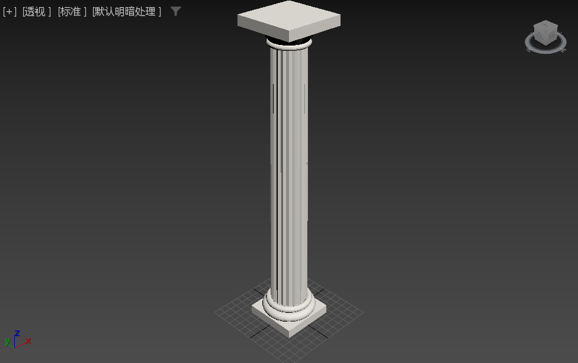
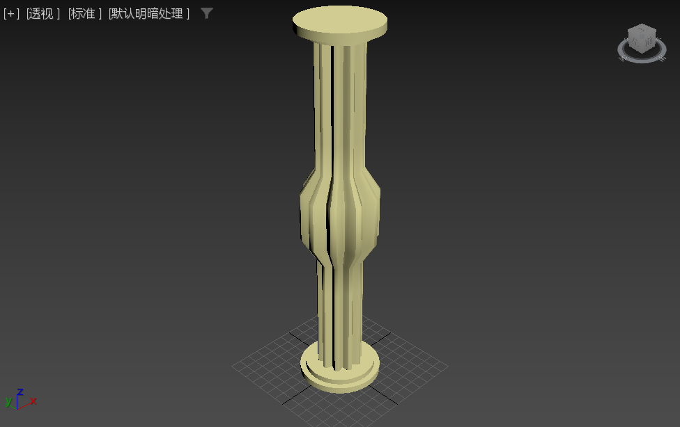

# MCP-driven DCC automation

**Run a script inside a live DCC application, then read the result back and prove it.**

A working pattern for driving desktop 3D tools (3ds Max here, but the shape transfers) from
an agent or a plain script: the host exposes an **MCP** endpoint, the client sends **JSON-RPC**,
and every step ends with **evidence** — a viewport image plus measured geometry — instead of
"it ran without errors".

The reference client in `examples/` is dependency-free Python; Hermes is one client among many.
Any MCP-capable client (Claude Desktop, Cline, Codex, a 20-line script) can drive the same host.

---

## 1. 问题

手工做一次"改模型 → 看效果"的循环，要开 Max、开脚本编辑器、粘贴、执行、切视口、摆角度、截图。
一次几十个点击，而且**下一轮无法比较**——你只有一张图，说不清参数到底生效没有。

这条链解决的是三件事：

| 目标 | 做法 |
|---|---|
| 不用点界面 | 宿主内置 MCP 服务器，脚本走 HTTP 提交到主线程执行 |
| 可重放 | 同一段脚本再调一次，场景重建，输入输出一致 |
| 可核验 | 视口截图 + 回读几何数字，两个证据互相校验 |

第三种才是最容易被忽略的：**没有证据的自动化只是"跑了"**。

## 2. 架构

```
┌──────────────────┐   JSON-RPC over HTTP   ┌─────────────────────────────┐
│  client          │ ─────────────────────► │  DCC host (3ds Max)         │
│  (any agent /    │  initialize             │  ├─ MCP server (in-process) │
│   plain script)  │  load_skill(...)        │  ├─ skill registry (25)     │
│                  │  tools/call             │  ├─ typed tools (72)        │
└──────────────────┘ ◄───────────────────── │  └─ main-thread dispatch    │
        ▲            stdout / PNG path       └─────────────────────────────┘
        │
        └── 证据：视口 PNG + 回读的几何数字
```

三层各自独立：

1. **接口层** — 宿主暴露 MCP（`dcc-mcp-3dsmax`，随 Max 启动，监听在随机回环端口）
2. **编排层** — 客户端按 `load_skill → tools/call` 决定步骤（skill 是宿主自带的工具分组）
3. **证据层** — `capture_viewport` 落 PNG；`execute_python` 里 `print` 的内容进 `stdout`

## 3. 一次调用的完整链路

```
POST /mcp  initialize            {"protocolVersion": "2025-06-18", ...}
POST /mcp  notifications/initialized
POST /mcp  tools/call  load_skill {"skill_name": "3dsmax-scripting"}
POST /mcp  tools/call  load_skill {"skill_name": "3dsmax-viewport"}
POST /mcp  tools/call  3dsmax_scripting__execute_python
                        {"code": "<script>", "confirm_execution": true}
POST /mcp  tools/call  3dsmax_viewport__capture_viewport
                        {"file_path": "C:/out/viewport.png"}
```

两个必须记住的细节：

- **`confirm_execution: true` 是必填**。缺这个字段直接 `missing required field` —— 这是宿主对"任意代码执行"的显式确认，不是可选参数。
- **`execute_python` 在主线程执行并回传 `stdout`**。这就是自证的通道：脚本里 `print` 的数字，客户端能原样拿到并断言。

## 4. 快速开始

前提：3ds Max 已安装，且宿主侧的 MCP 适配器已装好（启动 Max 后进程里会有一行
`MCP HTTP server ... listening on http://127.0.0.1:<port>/mcp`）。

```bash
# 1. 端口可以自动探测（取 3dsmax.exe 的 PID ∩ 监听的回环端口，再握手确认）
python examples/run_script.py --script examples/roman_column.py --port auto --shot out/column.png

# 2. 回读几何：证明锥化真的生效（而不是"看起来变细了"）
python examples/run_script.py --script examples/verify_radii.py --port auto --no-frame
```

`run_script.py` 的退出码只有在**宿主返回 `success: true`** 且**截图文件真的落盘**时才是 0。
工具调用返回一段散文不算成功。

只想要客户端库：

```python
from mcp_client import DccMcp

c = DccMcp("http://127.0.0.1:52796/mcp")
c.load_skill("3dsmax-scripting")
print(c.call("3dsmax_scripting__execute_python",
             {"code": "print(1+1)", "confirm_execution": True}))
```

## 5. 验证结果（本机实测）

跑 `examples/roman_column.py`，客户端拿到的不是"完成"，而是这些数字：

```
对象数      7
顶点数      520
柱身高      340.0
底半径      23.00
顶半径      19.55
ratio       0.85      ← 顶部/底部，TAPER -0.15 生效
修改器栈    Taper → Extrude
```

`ratio` 由 `verify_radii.py` 遍历 520 个顶点、按高度分带求平均半径得出。
**截图回答"像不像"，数字回答"对不对"** —— 两者都要。

| 直柱（Taper 修改器） | 手搓网格（中部腰部放大） |
|---|---|
|  |  |

## 6. 换一个 DCC 要改什么

只改**服务器**，客户端和证据模式不动：

- Blender / Maya / Houdini 也各有 MCP 适配器（`dcc-mcp-*`），端点形状一致
- 工具名会变（`blender_*`、`maya_*`），`load_skill` 的名字会变
- 证据那一半要换：视口截图 / 渲染帧 / 属性回读，视宿主给什么

也就是说，**这套东西的价值不在 Max**，在"接口 + 编排 + 证据"这个结构。

## 7. 边界

- 宿主**必须开着**；从进程启动到能握手，本机实测约 90 秒
- 端口**每次启动都变**（见过 51711、52796），所以要么自动探测，要么从日志里读
- 视口截图需要 GUI；纯批处理模式（`3dsmaxbatch`）没有视口
- 它是**按需触发**，不是定时任务；没有"每晚自动跑"
- 宿主内嵌解释器的能力受宿主版本约束，升级后工具名和行为可能变

## 8. 踩到的坑（实测）

这三条不会出现在官方文档里，是跑出来的：

1. **`node.modifiers` 在 pymxs 里是 0 基的**，MaxScript 里是 1 基。
   写成 `for i in range(1, count+1)` 会 `Index out of range`，而 MaxScript 版同样的循环是对的。
2. **`mesh.verts[i]` 不是顶点**，它返回一个 `VertexSelection` 包装器，没有 `.x/.z`。
   取顶点要用 `rt.getVert(mesh, i)`，**索引 1 基**，返回值才可按下标取分量（`v[0], v[1], v[2]`）。
3. Windows 控制台工具的输出**按本地编码**（中文系统上 `netstat` 是 GBK）。
   Python 用 `text=True` 读会在读线程里抛 `UnicodeDecodeError`，而且 `stdout` 直接变成 `None`——
   报错信息完全指不到真正的位置。先读字节再按 utf-8 → 本地编码 → gbk 依次解码。

## 9. 文件

```
examples/
  mcp_client.py    零依赖 MCP 客户端（initialize / list_tools / call / load_skill）
  run_script.py    跑脚本 + 取景 + 截图，端口可自动探测，退出码即断言
  roman_column.py  示例脚本：罗马柱（星形截面 + Extrude + Taper）
  verify_radii.py  回读几何，输出 ratio / 修改器栈（证明参数真的生效）
docs/img/          实测视口截图
```

## 许可

MIT，见 [LICENSE](LICENSE)。
